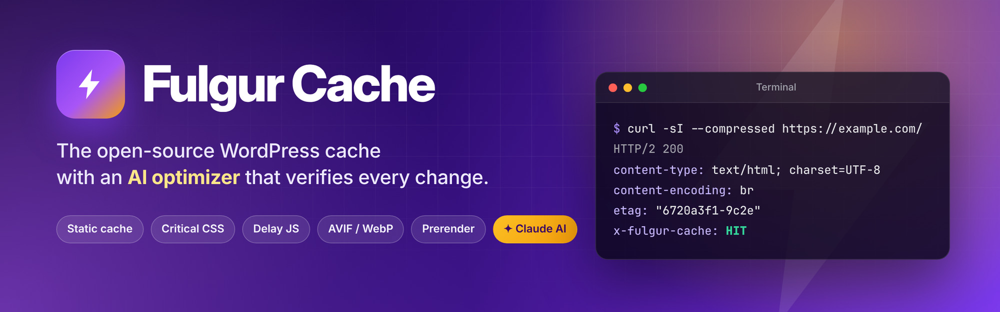
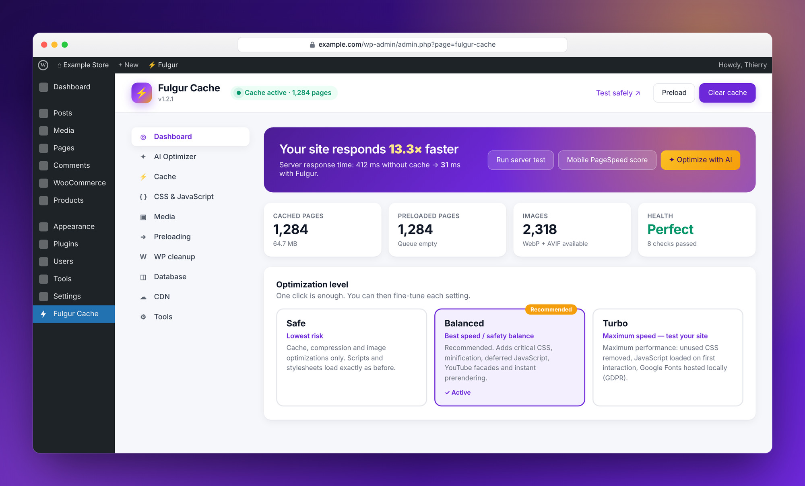
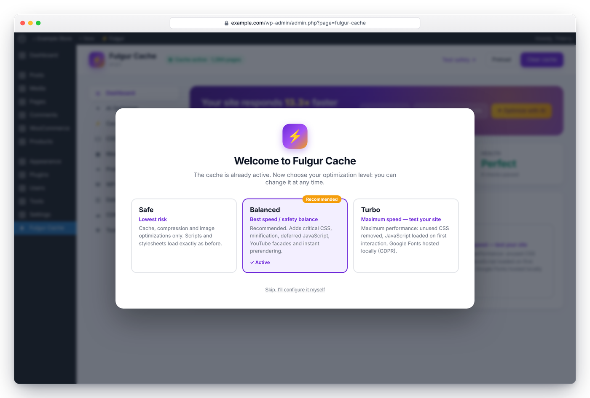
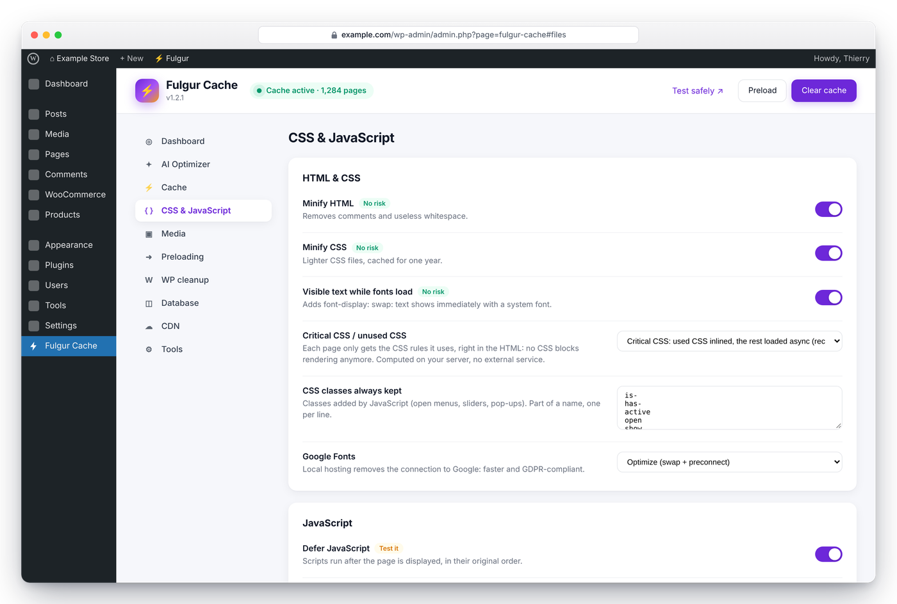
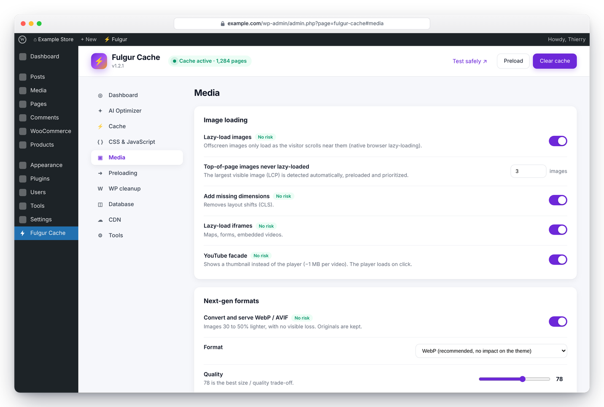
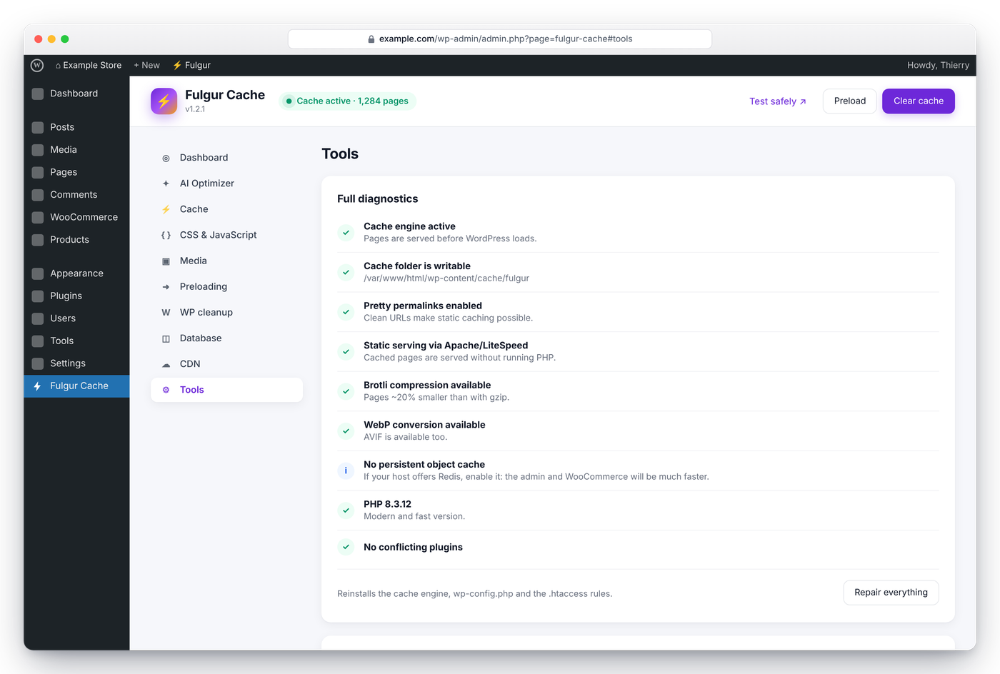
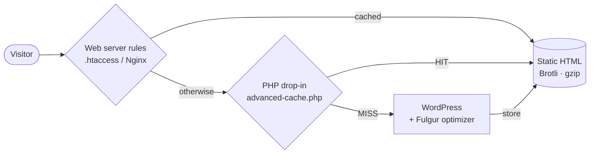
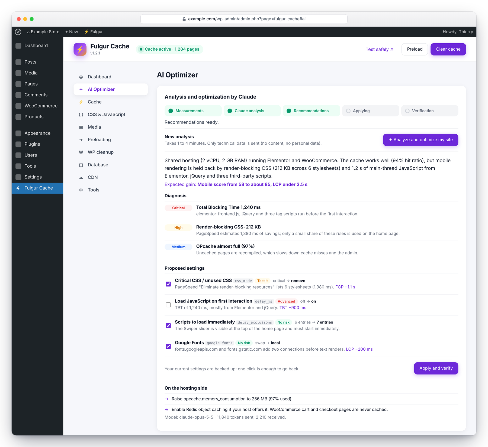
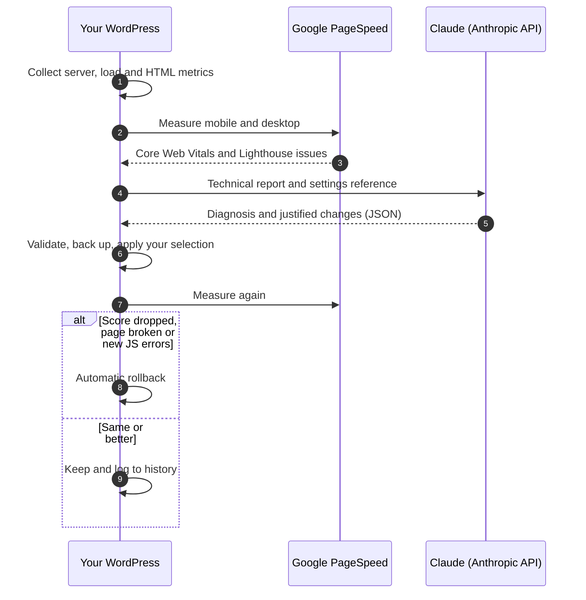

<p align="center">
  
</p>

<p align="center">
  <a href="https://github.com/Jacckisback/fulgur-cache/releases/latest"></a>
  
  
  <a href="LICENSE"></a>
  
  
</p>

<p align="center">
  <b>Static page cache · Critical CSS · Delayed JavaScript · AVIF/WebP · Instant navigation · AI optimizer</b><br>
  Free and open source. No account, no license key, no “Pro” upsell.
</p>

<p align="center">
  <a href="#quick-start"><b>Quick start</b></a> ·
  <a href="#features"><b>Features</b></a> ·
  <a href="#the-ai-optimizer"><b>AI optimizer</b></a> ·
  <a href="#configuration-reference"><b>Configuration</b></a> ·
  <a href="#for-developers"><b>Developers</b></a> ·
  <a href="#faq"><b>FAQ</b></a> ·
  <a href="#en-français"><b>Français</b></a>
</p>

<p align="center">
  <br>
  <sub>The Fulgur dashboard in the WordPress admin (demo data).</sub>
</p>

---

## Why Fulgur

<table>
  <tr>
    <td width="33%" valign="top">
      <h3>⚡ Served before WordPress</h3>
      Pages are stored as static HTML, pre-compressed with Brotli and gzip, and served by your web server or a tiny drop-in. No PHP execution, no database query.
    </td>
    <td width="33%" valign="top">
      <h3>🎯 Critical CSS, no SaaS</h3>
      Each page gets only the CSS rules it actually uses, computed on your own server by a built-in CSS parser. No account, no quota, no third-party service.
    </td>
    <td width="33%" valign="top">
      <h3>🧠 AI that checks its own work</h3>
      Claude reads your server, traffic and PageSpeed data and proposes settings. Fulgur applies them, measures again, and rolls back on its own if things get worse.
    </td>
  </tr>
  <tr>
    <td width="33%" valign="top">
      <h3>🚀 Instant navigation</h3>
      Speculation Rules prerender the next page while the visitor hovers a link. A 1 KB fallback prefetches on hover in Safari and Firefox.
    </td>
    <td width="33%" valign="top">
      <h3>🖼️ Lighter media</h3>
      AVIF/WebP conversion, LCP image detection and preloading, native lazy-loading, YouTube facades and missing image dimensions added automatically.
    </td>
    <td width="33%" valign="top">
      <h3>🛡️ Safe by design</h3>
      Three profiles, a “Test safely” preview, a risk label on every option, atomic file writes, one-click repair and a clean uninstall.
    </td>
  </tr>
</table>

> **Fulgur** is Latin for *lightning*.

## Quick start

1. Download **[fulgur-cache.zip](https://github.com/Jacckisback/fulgur-cache/releases/latest/download/fulgur-cache.zip)** from the [latest release](https://github.com/Jacckisback/fulgur-cache/releases/latest).
2. In WordPress, go to **Plugins → Add New → Upload Plugin**, install and activate.
3. Pick a profile in the welcome screen. **Balanced** is recommended.
4. Deactivate any other caching plugin (Fulgur detects 15 of them and warns you).
5. *Optional:* open the **AI Optimizer** tab, connect your Anthropic API key and click **Analyze and optimize my site**.

With WP-CLI:

```bash
wp plugin install \
  https://github.com/Jacckisback/fulgur-cache/releases/latest/download/fulgur-cache.zip \
  --activate
wp fulgur profile balanced
wp fulgur preload
```

**Requirements**

| | Minimum | Recommended |
|---|---|---|
| WordPress | 6.2 | Latest version |
| PHP | 7.4 | 8.2 or later, with OPcache |
| Web server | Apache, LiteSpeed or Nginx | Apache or LiteSpeed (static rules are written automatically) |
| Permalinks | Any “pretty” structure | — |
| Optional | GD or Imagick (WebP), Imagick or PHP 8.1+ GD with AVIF (AVIF), PHP `brotli` extension | An [Anthropic API key](https://platform.claude.com/settings/keys) for the AI optimizer |

> [!NOTE]
> **Early release.** Fulgur is a young project. It is designed to fail safe (previews, backups, automatic rollback), but it has not yet been run on a wide variety of production sites. Try it on a staging copy first and [open an issue](https://github.com/Jacckisback/fulgur-cache/issues) if anything looks wrong.

## Screenshots

<table>
  <tr>
    <td width="50%" valign="top">
      
      <p align="center"><b>One-click setup</b><br><sub>Pick a profile; Fulgur preloads your pages and measures the gain.</sub></p>
    </td>
    <td width="50%" valign="top">
      
      <p align="center"><b>CSS &amp; JavaScript</b><br><sub>Critical CSS, defer and delay, with a risk label on every option.</sub></p>
    </td>
  </tr>
  <tr>
    <td width="50%" valign="top">
      
      <p align="center"><b>Media</b><br><sub>Lazy-loading, LCP priority, AVIF/WebP and YouTube facades.</sub></p>
    </td>
    <td width="50%" valign="top">
      
      <p align="center"><b>Diagnostics</b><br><sub>Every check explains the problem and how to fix it, with one-click repair.</sub></p>
    </td>
  </tr>
</table>

<p align="center"><sub>Screenshots use demo data.</sub></p>

## Features

### Page cache
- **Static HTML cache** stored per host and URL, with Brotli (when the PHP `brotli` extension is available) and gzip copies written next to it.
- **Served without PHP** by `.htaccess` rules on Apache/LiteSpeed (written automatically) or a copy-paste Nginx configuration; otherwise by the `advanced-cache.php` drop-in, before WordPress loads, with `ETag` / `304 Not Modified` support.
- **Smart purge**: editing a post clears only that post, the home page, the posts page, its archive, categories, tags, author page and adjacent posts. Comments, term edits and WooCommerce stock changes are handled too. Site-wide changes (theme, menus, widgets, customizer, plugin updates, permalinks) clear everything.
- **Preloading**: after any purge, every public page is rebuilt in the background, most recently modified first, so visitors never hit a cold page.
- **Smart bypass**: logged-in users, `POST` requests, carts, checkouts, accounts, search results, previews, password-protected posts, REST and admin URLs are never cached. Tracking parameters (`utm_*`, `gclid`, `fbclid`…) still get the cached page.
- **Atomic writes**: files are written to a temporary name and renamed, so a visitor never receives a half-written page.

### CSS
- **Critical CSS / unused CSS removal** computed per page by a PHP CSS parser (`@media`, `@supports`, `@layer`, `@container`, CSS nesting, `:is()`, `:not()`, escaped class names such as Tailwind's `md\:flex`). Unused `@font-face` and `@keyframes` are dropped. In the test suite, a 646 KB stylesheet is reduced to the 20 KB a page actually uses.
- Two modes: **critical** (full stylesheets load asynchronously right after rendering) and **remove** (full stylesheets load on the first interaction). In both modes the original `<link>` tags stay in place, so the cascade order never changes.
- Safelist for classes added by JavaScript (open menus, sliders, pop-ups), with sensible defaults.
- Minification of local stylesheets, `font-display: swap` added to `@font-face` rules, and **Google Fonts hosted locally** (GDPR-friendly, one connection less) or optimized with `display=swap` and a preconnect.

### JavaScript
- **Defer** with the original execution order preserved: inline scripts are turned into `data:` URIs, and inline scripts that belong to an excluded WordPress script handle (`-js-extra`, `-js-before`, `-js-after`, `-js-translations`) stay with it.
- **Delay until first interaction** (mouse, touch, keyboard, scroll), with an optional timeout. Delayed scripts run in their original order, then `DOMContentLoaded` and `load` listeners are replayed so jQuery-ready code still works.
- Separate exclusion lists for defer and delay. JSON-LD, templates, import maps and speculation rules are never touched.

### Media
- **WebP/AVIF conversion** on upload, in bulk from the admin (with a progress bar), or on the fly for theme images. Variants are saved next to the originals (`photo.jpg.webp`) and skipped when they would be heavier. Google reports WebP images [25–34% smaller than comparable JPEGs](https://developers.google.com/speed/webp).
- **LCP detection**: the first meaningful image at the top of the page (logos, icons and avatars are ignored) gets `fetchpriority="high"` and a preload hint; the first images are never lazy-loaded.
- Native lazy-loading for images and iframes, missing `width`/`height` added to reduce layout shifts, and **YouTube facades** that load the player only on click.

### Instant navigation and hints
- **[Speculation Rules](https://developer.chrome.com/docs/web-platform/prerender-pages)**: prefetch or prerender on hover, with exclusions for admin, carts, query strings and `nofollow` links. On WordPress 6.8+, Fulgur configures the [built-in speculative loading](https://make.wordpress.org/core/2025/03/06/speculative-loading-in-6-8/) instead of adding a second set of rules.
- Hover prefetching fallback for browsers without Speculation Rules.
- `Link` preload headers for the LCP image and critical origins, which Cloudflare and compatible servers turn into **[103 Early Hints](https://developer.chrome.com/docs/web-platform/early-hints)**.

### WordPress cleanup, database, CDN
- Removes emoji scripts, embeds, Dashicons for visitors, RSD/WLW/shortlink/generator tags, jQuery Migrate (optional), XML-RPC; tunes or disables the Heartbeat API; removes WooCommerce `cart-fragments` outside shop pages.
- Database cleanup (revisions, auto-drafts, trash, spam, expired transients, orphaned metadata, table optimization), manual or weekly.
- CDN URL rewriting for static files, and automatic **Cloudflare** purge (only the affected URLs when possible).

### Admin experience
- Three profiles, an onboarding wizard that preloads and measures, a built-in server response test and mobile PageSpeed score.
- **Test safely**: preview any page with optimizations applied, without caching anything (`?fulgur_preview=1`, admins only).
- Admin bar menu (clear all, clear this page, preview), “Clear cache” link on posts and pages, import/export of settings.
- Diagnostics with one-click repair, conflict detection, and a dashboard of cache, preload and image stats.
- Interface in English and French; the AI optimizer answers in the admin's language.

## How it works



1. **Web server.** On Apache and LiteSpeed, `.htaccess` rules serve `wp-content/cache/fulgur/<host>/<path>/index.html` (or its `.br`/`.gz` copy) directly. Nginx does the same with the provided configuration.
2. **Drop-in.** When no static rule applies, `advanced-cache.php` runs before WordPress, checks the bypass rules, negotiates Brotli/gzip and answers `304 Not Modified` when the browser already has the page.
3. **Cache miss.** WordPress renders the page once. Fulgur's optimizer then processes the HTML in this order: Google Fonts → CSS minification → images and iframes → critical CSS → JavaScript defer/delay → resource hints and speculation rules → CDN rewriting → HTML minification. The result is stored atomically with its compressed copies.

## The AI optimizer

<p align="center">
  <br>
  <sub>Recommendations waiting for approval (demo data).</sub>
</p>

The AI optimizer turns Fulgur's settings into a closed loop: **measure → analyze → apply → verify → keep or roll back**.



- **Every change is justified.** Claude is instructed to cite the measurement behind each recommendation and to rate its risk (*no risk*, *test it*, *advanced*). Advanced changes are unticked by default.
- **Guardrails.** Proposals are validated against the list of allowed settings and values. The AI can never disable the cache, touch the CDN or Cloudflare settings, or read your API keys. It only changes Fulgur settings, never your theme, plugins or content.
- **Verification.** After applying, Fulgur reloads the home page and, when PageSpeed is enabled, measures it again. It restores the previous settings if the page no longer renders, if the mobile score drops by more than 3 points, or if new JavaScript errors appear in the console.
- **Learning from history.** The last 10 runs (scores, changes, rollbacks) are sent with the next report, so a rolled-back setting isn't proposed again unchanged.
- **Runs in the background** through WP-Cron, step by step, so shared-hosting time limits are never hit. If WP-Cron is disabled, the admin page drives the steps itself.
- **Autopilot (optional):** a weekly analysis that either emails you the recommendations or applies only the *no risk* ones, with the same verification and rollback.

<details>
<summary><b>What is sent to Claude</b></summary>

<br>

A technical report, never your content or your visitors' data:

- **Server:** web server software, PHP version and limits, OPcache usage, CPU cores, memory, load average, free disk space, object cache, Brotli/WebP/AVIF support, WP-Cron status, and the home page response time without and with cache.
- **Load:** pages served from the cache (sampled) and pages generated by WordPress over the last 7 days, average generation time, peak hour, peak memory.
- **WordPress:** version, locale, theme, active plugins (names and versions), number of published posts, pages and products, WooCommerce presence.
- **Settings:** current Fulgur settings, without CDN URL or Cloudflare credentials.
- **Home page audit:** HTML size, number of scripts and stylesheets, script paths, third-party domains, detected page builders, Google Fonts usage.
- **PageSpeed (optional):** mobile and desktop scores, Core Web Vitals, the main Lighthouse issues and the HTML snippet of the largest element, as reported by Google.
- **Diagnostics and history** of previous optimizations.

Requests use structured JSON output. With Claude Opus 5.5 and Sonnet 5.5, they also opt into Anthropic's server-side fallback, in case a safety classifier declines the request.
</details>

**Cost.** Usage is billed by Anthropic on your own API key. A typical analysis sends 8–15k tokens and receives 3–10k (including the model's reasoning). At [Anthropic's published prices](https://claude.com/pricing) (checked October 2026), that is about:

| Model | Price per million tokens (input / output) | Estimated cost per analysis |
|---|---|---|
| Claude Opus 5.5 *(default, most accurate)* | $4 / $20 | $0.10 – $0.30 |
| Claude Sonnet 5.5 | $2 / $10 | $0.05 – $0.15 |
| Claude Haiku 5.5 | $0.10 / $0.50 | under $0.01 |

The exact token count is shown after each analysis. One analysis a week is plenty.

**Setup.** Paste your key in the AI Optimizer tab, or, safer, define it in `wp-config.php`:

```php
define( 'FULGUR_ANTHROPIC_API_KEY', 'sk-ant-...' );
define( 'FULGUR_PSI_API_KEY', 'AIza...' ); // Optional: higher PageSpeed quota.
```

A [PageSpeed Insights API key](https://developers.google.com/speed/docs/insights/v5/get-started) is free and avoids Google's anonymous rate limits. PageSpeed can only measure a site that is publicly reachable.

## Profiles

Each profile applies the values below; every other setting keeps its current value. You can fine-tune anything afterwards.

| | Safe | Balanced *(default)* | Turbo |
|---|:---:|:---:|:---:|
| Page cache | ✅ | ✅ | ✅ |
| Minify HTML | ✅ | ✅ | ✅ |
| Minify CSS | — | ✅ | ✅ |
| Critical / unused CSS | `off` | `critical` | `remove` |
| Defer JavaScript | — | ✅ | ✅ |
| Delay JavaScript until interaction | — | — | ✅ |
| Lazy-load images | ✅ | ✅ | ✅ |
| Lazy-load iframes | ✅ | ✅ | ✅ |
| YouTube facade | — | ✅ | ✅ |
| WebP / AVIF | ✅ | ✅ | ✅ |
| Speculation Rules | `prefetch` | `prerender` | `prerender` |
| Google Fonts | `swap` | `swap` | `local` |
| Heartbeat API | `reduce` | `reduce` | `disable_front` |

## Configuration reference

Settings are stored in the `fulgur_settings` option. Export and import them from **Tools → Settings backup**.

<details>
<summary><b>Show all 52 settings</b></summary>

<br>

**Cache**

| Setting | Key | Default | Description |
|---|---|---|---|
| Page cache | `page_cache` | `on` | Serves each page as static HTML, before WordPress loads. |
| Cache lifespan (hours) | `cache_lifespan` | `10` | Hours before a cached page is regenerated (0 = unlimited, smart purge is enough). |
| Compression and browser cache | `browser_cache` | `on` | Server compression + 1-year browser caching of static files (.htaccess). |
| Separate mobile cache | `cache_mobile` | `off` | Separate cache for mobile visitors. Only useful if the theme serves different HTML on mobile. |
| Cache 404 pages | `cache_404` | `off` | Caches 404 pages (protects against bots). |
| URLs never cached | `exclude_urls` | `/cart/`, `/checkout/`, `/my-account/` … (9) | Never cached. One pattern per line: part of a URL, a wildcard (`*`) or a regex (`#…#`). |
| Ignored URL parameters | `ignored_query_params` | `utm_source`, `utm_medium`, `utm_campaign` … (15) | Tracking parameters ignored when looking up the cache, so campaign links still get the cached page. |
| Cookies that disable the cache | `exclude_cookies` | — | Extra cookie names (or prefixes) that bypass the cache. Login, comment and WooCommerce cart cookies are always handled. |
| Excluded user agents | `exclude_user_agents` | — | User-agent substrings that bypass the cache. |

**CSS & JavaScript**

| Setting | Key | Default | Description |
|---|---|---|---|
| Minify HTML | `minify_html` | `on` | Removes comments and redundant whitespace from the HTML. |
| Minify CSS | `minify_css` | `on` | Minifies local stylesheets into cached copies (relative URLs rewritten). |
| font-display: swap | `font_display_swap` | `on` | Adds font-display:swap to @font-face rules. |
| Critical / unused CSS | `css_mode` | `off` | Off; critical (CSS used by the page inlined + full stylesheets loaded async, safe); remove (full stylesheets loaded only on first interaction, maximum gain, risk for elements added by JS). |
| CSS classes always kept | `css_safelist` | `is-`, `has-`, `active` … (29) | CSS class patterns always kept by css_mode (classes added dynamically by JS). |
| Google Fonts | `google_fonts` | `swap` | Off; swap (display=swap + preconnect); local (fonts hosted on the site, GDPR, one less connection). |
| Defer JavaScript | `defer_js` | `off` | Scripts deferred, order preserved, inline scripts turned into data URIs. |
| Scripts not deferred | `defer_exclusions` | — | Patterns (URL or code) of scripts not to defer. |
| Delay JavaScript until interaction | `delay_js` | `off` | JavaScript runs only on first user interaction (huge TBT gain, risk for sliders/menus visible on load). |
| Force loading after (s) | `delay_timeout` | `0` | Seconds before delayed scripts are forced to load (0 = interaction only). |
| Scripts loaded immediately | `delay_exclusions` | `fulgur-`, `recaptcha`, `cookie` … (6) | Patterns (URL or code) of scripts loaded immediately despite delay_js. |

**Media**

| Setting | Key | Default | Description |
|---|---|---|---|
| Lazy-load images | `lazy_images` | `on` | Native lazy-loading of offscreen images. |
| Top images never lazy-loaded | `eager_images` | `3` | Number of above-the-fold images never lazy-loaded (the LCP image is detected and preloaded). |
| Add missing dimensions | `image_dimensions` | `on` | Adds missing width/height (CLS). |
| Lazy-load iframes | `lazy_iframes` | `on` | Native lazy-loading for iframes (maps, forms, embeds). |
| YouTube facade | `youtube_facade` | `on` | Thumbnail instead of the YouTube player until click. |
| WebP / AVIF | `next_gen_images` | `on` | WebP/AVIF conversion and serving. |
| Image format | `image_format` | `webp` | Webp (direct replacement) or avif (<picture> AVIF+WebP, needs an AVIF encoder). |
| Conversion quality | `image_quality` | `78` | Conversion quality 50-95. |

**Preloading**

| Setting | Key | Default | Description |
|---|---|---|---|
| Preload the cache | `preload_cache` | `on` | Rebuilds every page in the background after a purge. |
| Speculation Rules | `speculation` | `prerender` | Speculation Rules: off, prefetch, prerender (prerender = instant navigation but more server load). |
| Speculation trigger | `speculation_eagerness` | `moderate` | Conservative (on click), moderate (on hover), eager. |
| Hover prefetch (Safari / Firefox) | `instant_fallback` | `on` | Hover prefetch for Safari/Firefox. |
| Early Hints headers | `early_hints` | `on` | Preload Link headers (103 Early Hints). |
| Domains to preconnect | `preconnect_domains` | — | Critical third-party domains to preconnect. |

**WordPress cleanup**

| Setting | Key | Default | Description |
|---|---|---|---|
| Disable emojis | `disable_emojis` | `on` | Removes the emoji script. |
| Disable embeds | `disable_embeds` | `on` | Removes the wp-embed script and oEmbed discovery links. |
| Remove Dashicons for visitors | `dashicons_visitors` | `on` | Removes Dashicons for visitors. |
| Clean the HTML head | `clean_head` | `on` | Cleans the HTML head. |
| Disable XML-RPC | `disable_xmlrpc` | `on` | Disables XML-RPC (careful with Jetpack / mobile app). |
| Remove jQuery Migrate | `remove_jquery_migrate` | `off` | Removes jQuery Migrate (risk with old plugins). |
| Heartbeat API | `heartbeat` | `reduce` | Heartbeat API: default, reduce (60 s), disable_front, disable. |
| WooCommerce cart-fragments | `wc_cart_fragments` | `on` | Removes WooCommerce cart-fragments outside shop pages. |

**Database**

| Setting | Key | Default | Description |
|---|---|---|---|
| Weekly database cleanup | `db_auto_clean` | `off` | Weekly cleanup: revisions, auto-drafts, spam and trashed comments, expired transients. |
| Revisions kept per post | `db_revisions_keep` | `5` | Revisions kept per post by the cleanup. |

**CDN & Cloudflare**

| Setting | Key | Default | Description |
|---|---|---|---|
| CDN | `cdn_enabled` | `off` | Rewrites static file URLs (wp-content, wp-includes) to the CDN. |
| CDN URL | `cdn_url` | — | CDN base URL, e.g. https://cdn.example.com. |
| Files excluded from the CDN | `cdn_exclusions` | `.php` | URL patterns never rewritten to the CDN. |
| Cloudflare API token | `cloudflare_token` | — | API token with the Zone › Cache Purge permission; the Cloudflare cache is purged together with Fulgur's. |
| Cloudflare zone ID | `cloudflare_zone` | — | Cloudflare zone ID of the domain. |

**AI optimizer**

| Setting | Key | Default | Description |
|---|---|---|---|
| AI model | `ai_model` | `claude-opus-5-5` | Claude model used by the AI optimizer. |
| Autopilot | `ai_auto` | `off` | Off; suggest (weekly analysis, recommendations by email); auto (weekly analysis, safe changes applied, automatic rollback). |
| Include PageSpeed data | `ai_psi` | `on` | Adds Google PageSpeed mobile and desktop data to the report sent to Claude. |
</details>

## Server setup

**Apache and LiteSpeed.** Nothing to do: Fulgur writes its rules at the top of `.htaccess` (between `# BEGIN Fulgur Cache` and `# END Fulgur Cache`) and removes them on deactivation. If `.htaccess` isn't writable, the cache still works through the PHP drop-in and the diagnostics tell you how to fix it.

<details>
<summary><b>Rules written to <code>.htaccess</code> (default settings)</b></summary>

<br>

```apache
# BEGIN Fulgur Cache
<IfModule mod_mime.c>
  AddType image/avif .avif
  AddType image/webp .webp
  AddType font/woff2 .woff2
</IfModule>
<IfModule mod_deflate.c>
  AddOutputFilterByType DEFLATE text/html text/css text/plain text/xml application/javascript application/json application/xml image/svg+xml font/ttf font/otf
</IfModule>
<IfModule mod_brotli.c>
  AddOutputFilterByType BROTLI_COMPRESS text/html text/css text/plain text/xml application/javascript application/json application/xml image/svg+xml
</IfModule>
<IfModule mod_expires.c>
  ExpiresActive On
  ExpiresByType text/html "access plus 0 seconds"
  ExpiresByType text/css "access plus 1 year"
  ExpiresByType application/javascript "access plus 1 year"
  ExpiresByType image/avif "access plus 1 year"
  ExpiresByType image/webp "access plus 1 year"
  ExpiresByType image/jpeg "access plus 1 year"
  ExpiresByType image/png "access plus 1 year"
  ExpiresByType image/gif "access plus 1 year"
  ExpiresByType image/svg+xml "access plus 1 year"
  ExpiresByType image/x-icon "access plus 1 year"
  ExpiresByType font/woff2 "access plus 1 year"
  ExpiresByType video/mp4 "access plus 1 year"
</IfModule>
<IfModule mod_headers.c>
  <FilesMatch "\.(css|js|avif|webp|jpe?g|png|gif|svg|ico|woff2?|ttf|otf|mp4|webm)$">
    Header set Cache-Control "public, max-age=31536000, immutable"
  </FilesMatch>
</IfModule>
<IfModule mod_mime.c>
  AddEncoding br .br
  AddEncoding gzip .gz
</IfModule>
<FilesMatch "\.html\.(br|gz)$">
  <IfModule mod_headers.c>
    Header set Content-Type "text/html; charset=UTF-8"
    Header append Vary Accept-Encoding
  </IfModule>
  <IfModule mod_deflate.c>
    SetEnv no-gzip 1
  </IfModule>
  <IfModule mod_brotli.c>
    SetEnv no-brotli 1
  </IfModule>
</FilesMatch>
<IfModule mod_rewrite.c>
  RewriteEngine On
  RewriteBase /
  RewriteCond %{REQUEST_METHOD} GET
  RewriteCond %{QUERY_STRING} =""
  RewriteCond %{REQUEST_URI} /$
  RewriteCond %{HTTP:Cookie} !(wordpress_logged_in_|wp\-postpass_|comment_author_|woocommerce_items_in_cart|wp_woocommerce_session_|edd_items_in_cart|fulgur_nocache) [NC]
  RewriteCond %{REQUEST_URI} !/cart/ [NC]
  RewriteCond %{REQUEST_URI} !/checkout/ [NC]
  RewriteCond %{REQUEST_URI} !/my\-account/ [NC]
  RewriteCond %{REQUEST_URI} !/panier/ [NC]
  RewriteCond %{REQUEST_URI} !/commande/ [NC]
  RewriteCond %{REQUEST_URI} !/mon\-compte/ [NC]
  RewriteCond %{REQUEST_URI} !/carrito/ [NC]
  RewriteCond %{REQUEST_URI} !/finalizar\-compra/ [NC]
  RewriteCond %{REQUEST_URI} !/mi\-cuenta/ [NC]
  RewriteCond %{HTTP:Accept-Encoding} br
  RewriteCond "%{DOCUMENT_ROOT}/wp-content/cache/fulgur/%{HTTP_HOST}%{REQUEST_URI}index.html.br" -f
  RewriteRule .* "/wp-content/cache/fulgur/%{HTTP_HOST}%{REQUEST_URI}index.html.br" [L]
  RewriteCond %{REQUEST_METHOD} GET
  RewriteCond %{QUERY_STRING} =""
  RewriteCond %{REQUEST_URI} /$
  RewriteCond %{HTTP:Cookie} !(wordpress_logged_in_|wp\-postpass_|comment_author_|woocommerce_items_in_cart|wp_woocommerce_session_|edd_items_in_cart|fulgur_nocache) [NC]
  RewriteCond %{REQUEST_URI} !/cart/ [NC]
  RewriteCond %{REQUEST_URI} !/checkout/ [NC]
  RewriteCond %{REQUEST_URI} !/my\-account/ [NC]
  RewriteCond %{REQUEST_URI} !/panier/ [NC]
  RewriteCond %{REQUEST_URI} !/commande/ [NC]
  RewriteCond %{REQUEST_URI} !/mon\-compte/ [NC]
  RewriteCond %{REQUEST_URI} !/carrito/ [NC]
  RewriteCond %{REQUEST_URI} !/finalizar\-compra/ [NC]
  RewriteCond %{REQUEST_URI} !/mi\-cuenta/ [NC]
  RewriteCond %{HTTP:Accept-Encoding} gzip
  RewriteCond "%{DOCUMENT_ROOT}/wp-content/cache/fulgur/%{HTTP_HOST}%{REQUEST_URI}index.html.gz" -f
  RewriteRule .* "/wp-content/cache/fulgur/%{HTTP_HOST}%{REQUEST_URI}index.html.gz" [L]
  RewriteCond %{REQUEST_METHOD} GET
  RewriteCond %{QUERY_STRING} =""
  RewriteCond %{REQUEST_URI} /$
  RewriteCond %{HTTP:Cookie} !(wordpress_logged_in_|wp\-postpass_|comment_author_|woocommerce_items_in_cart|wp_woocommerce_session_|edd_items_in_cart|fulgur_nocache) [NC]
  RewriteCond %{REQUEST_URI} !/cart/ [NC]
  RewriteCond %{REQUEST_URI} !/checkout/ [NC]
  RewriteCond %{REQUEST_URI} !/my\-account/ [NC]
  RewriteCond %{REQUEST_URI} !/panier/ [NC]
  RewriteCond %{REQUEST_URI} !/commande/ [NC]
  RewriteCond %{REQUEST_URI} !/mon\-compte/ [NC]
  RewriteCond %{REQUEST_URI} !/carrito/ [NC]
  RewriteCond %{REQUEST_URI} !/finalizar\-compra/ [NC]
  RewriteCond %{REQUEST_URI} !/mi\-cuenta/ [NC]
  RewriteCond "%{DOCUMENT_ROOT}/wp-content/cache/fulgur/%{HTTP_HOST}%{REQUEST_URI}index.html" -f
  RewriteRule .* "/wp-content/cache/fulgur/%{HTTP_HOST}%{REQUEST_URI}index.html" [L]
</IfModule>
# END Fulgur Cache
```
</details>

**Nginx.** The cache already works through the PHP drop-in. For fully static serving, add this to your `server` block (the same snippet, adapted to your paths, is in **Tools → Nginx configuration**) and reload Nginx:

<details>
<summary><b>Nginx configuration</b></summary>

<br>

```nginx
# --- Fulgur Cache: static serving without PHP ---
set $fulgur_file "/wp-content/cache/fulgur/$host${uri}index.html";
set $fulgur_ok 1;
if ($request_method != GET) { set $fulgur_ok 0; }
if ($args != "") { set $fulgur_ok 0; }
if ($http_cookie ~* "(wordpress_logged_in_|wp-postpass_|comment_author_|woocommerce_items_in_cart|wp_woocommerce_session_|edd_items_in_cart|fulgur_nocache)") { set $fulgur_ok 0; }
if ($uri !~ /$) { set $fulgur_ok 0; }
if ($fulgur_ok = 0) { set $fulgur_file "/nonexistent"; }

gzip_static on;        # serves index.html.gz when present
# brotli_static on;    # uncomment if the ngx_brotli module is installed

location / {
    try_files $fulgur_file $uri $uri/ /index.php?$args;
}

location ~* \.(css|js|avif|webp|jpe?g|png|gif|svg|ico|woff2?|ttf|mp4)$ {
    expires 1y;
    add_header Cache-Control "public, max-age=31536000, immutable";
    access_log off;
}
```
</details>

**Cloudflare.** Create an [API token](https://developers.cloudflare.com/fundamentals/api/get-started/create-token/) with the *Zone → Cache Purge* permission, then paste it with your zone ID in the CDN tab. Fulgur purges the affected URLs on Cloudflare whenever it purges its own cache.

**CDN.** Enter your CDN URL (BunnyCDN, KeyCDN…) in the CDN tab: images, CSS, JavaScript and fonts from `wp-content` and `wp-includes` are rewritten to it.

## WP-CLI

| Command | Description |
|---|---|
| `wp fulgur clear [--url=<url>]` | Clear the whole cache, or a single URL |
| `wp fulgur preload` | Preload every public page now, with a progress bar |
| `wp fulgur status` | Cache size and full diagnostics |
| `wp fulgur profile <safe\|balanced\|turbo>` | Apply a profile |
| `wp fulgur images` | Convert the whole media library to WebP/AVIF |
| `wp fulgur db` | Run every database cleanup task |

## For developers

**Filters**

| Filter | Arguments | Purpose |
|---|---|---|
| `fulgur_is_cacheable` | `bool $cacheable` | Prevent the current page from being cached |
| `fulgur_optimize_page` | `bool $optimize` | Disable the optimizer on the current page |
| `fulgur_html_before` / `fulgur_html_after` | `string $html` | Alter the HTML before or after optimization |
| `fulgur_purge_post_urls` | `array $urls, int $post_id` | URLs purged when a post changes |
| `fulgur_preload_urls` | `array $urls` | URLs to preload, in order |
| `fulgur_css_exclusions` | `array $patterns` | Stylesheets never minified |

**Actions:** `fulgur_purged_url` (`$url`), `fulgur_purged_all`, `fulgur_settings_updated` (`$new`, `$old`), `fulgur_images_converted` (`$count`).

```php
// Never cache the members area.
add_filter( 'fulgur_is_cacheable', function ( $cacheable ) {
	return is_page( 'members' ) ? false : $cacheable;
} );

// Also refresh the shop page whenever a product changes.
add_filter( 'fulgur_purge_post_urls', function ( $urls, $post_id ) {
	if ( 'product' === get_post_type( $post_id ) && function_exists( 'wc_get_page_permalink' ) ) {
		$urls[] = wc_get_page_permalink( 'shop' );
	}
	return $urls;
}, 10, 2 );

// Preload the pricing page first.
add_filter( 'fulgur_preload_urls', function ( $urls ) {
	array_unshift( $urls, home_url( '/pricing/' ) );
	return $urls;
} );
```

**HTML opt-outs:** add `data-fulgur-skip` to a `<script>`, ``, `<iframe>` or `<link>` tag to leave it untouched, or `<meta name="fulgur-skip">` to skip optimizations on a whole page.

**Constants** (in `wp-config.php`): `FULGUR_ANTHROPIC_API_KEY`, `FULGUR_PSI_API_KEY`, `FULGUR_CACHE_DIR` (default `wp-content/cache/fulgur`), `FULGUR_CONFIG_DIR` (default `wp-content/fulgur-config`).

**Debugging**

- `curl -sI --compressed https://example.com/` shows `x-fulgur-cache: HIT` when a page comes from the PHP drop-in, and `MISS` when it was just generated. Pages served directly by `.htaccess` or Nginx carry no such header: look for the `<!-- Fulgur Cache: page optimized in … -->` comment at the end of the HTML instead.
- Add `?fulgur_off=1` to a URL to see the original, unoptimized page (not cached). Logged-in admins can use `?fulgur_preview=1` to see the optimized version without caching it.

<details>
<summary><b>REST API</b> (namespace <code>fulgur/v1</code>, requires <code>manage_options</code>)</summary>

<br>

| Method | Route | Description |
|---|---|---|
| `GET` | `/status` | Full state: settings, profiles, stats, diagnostics |
| `POST` | `/settings` | Save settings (`values` object) |
| `POST` | `/profile` | Apply a profile (`profile`) |
| `POST` | `/purge` | Clear everything, or one `url` |
| `POST` | `/preload` | Preload the whole site |
| `GET` / `POST` | `/database`, `/database/clean` | Count and clean (`tasks` array) |
| `POST` | `/images/bulk` | Convert the media library in batches (`offset`) |
| `POST` | `/repair` | Reinstall the drop-in, `wp-config.php` constant and server rules |
| `POST` | `/speedtest` | Measure server response time without and with cache |
| `POST` | `/cloudflare` | Test the Cloudflare credentials |
| `GET` / `POST` | `/export`, `/import`, `/reset` | Settings backup |
| `POST` | `/ai/key`, `/ai/start`, `/ai/apply`, `/ai/undo` | AI optimizer actions |
| `GET` | `/ai/status` | AI optimizer progress |
</details>

<details>
<summary><b>Project structure</b></summary>

<br>

```
fulgur-cache.php              Bootstrap, autoloader, text domain
templates/advanced-cache.php  Drop-in template (copied to wp-content)
includes/serve.php            Cache serving before WordPress (no WordPress dependency)
includes/class-page-cache.php Capture, storage (HTML + .gz + .br), purge
includes/class-purge.php      Smart purge rules
includes/class-preload.php    Background preloading
includes/class-optimizer.php  HTML optimization pipeline, JS defer/delay, speculation rules
includes/class-used-css.php   Critical / unused CSS (PHP CSS parser)
includes/class-assets.php     CSS minification, Google Fonts
includes/class-media.php      Images, LCP, iframes, YouTube facades
includes/class-images.php     WebP/AVIF conversion
includes/class-ai*.php        AI optimizer: report, Claude request, verification, autopilot
includes/class-metrics.php    Load metrics
includes/class-installer.php  Drop-in, WP_CACHE, .htaccess, Nginx rules
includes/class-admin.php      Admin page, admin bar, notices
includes/class-rest.php       REST API used by the admin app
assets/                       Admin app (vanilla JavaScript, no build step)
languages/                    Translations (.pot, .po, .mo, .l10n.php, JavaScript .json)
bin/i18n.py                   Translation tooling
```
</details>

## Compatibility and limitations

**Works with** any theme (classic or block), WooCommerce (carts, checkouts and accounts are never cached; stock changes purge the product), Apache, LiteSpeed, Nginx and Cloudflare, and WordPress 6.8+ speculative loading.

**Good to know**

- Logged-in users always get fresh, uncached pages, by design.
- URLs with query strings other than tracking parameters are not cached.
- Critical CSS is the CSS *used by the page*, computed from its HTML, not a viewport-based “above the fold” extraction. Only local stylesheets are processed.
- Fulgur doesn't minify or combine JavaScript files: most themes and plugins already ship minified files, and HTTP/2 makes combining unnecessary.
- `Link` preload headers (Early Hints) are sent when pages are served by the PHP drop-in; with `.htaccess` or Nginx static serving, the same hints remain in the HTML.
- Multisite hasn't been tested yet.
- The AI optimizer needs an Anthropic API key (paid usage) and a publicly reachable site for PageSpeed measurements.

## FAQ

<details>
<summary><b>Is it really free?</b></summary>

<br>

Yes. Fulgur is GPL-licensed, with no paid version, no account and no license key. The only optional cost is the Anthropic API usage of the AI optimizer, billed on your own key.
</details>

<details>
<summary><b>Do I need the AI optimizer?</b></summary>

<br>

No. Every feature works without it: pick a profile and fine-tune. The AI optimizer is there to choose settings for your specific server and traffic, and to verify them.
</details>

<details>
<summary><b>Can I keep my current caching plugin?</b></summary>

<br>

No. Two caching plugins fight over the same files and slow your site down. Fulgur detects 15 common caching and optimization plugins and tells you which ones to deactivate.
</details>

<details>
<summary><b>Will it break my site?</b></summary>

<br>

The **Safe** profile doesn't change how scripts and stylesheets load. **Balanced** is designed to be safe on most sites. **Turbo** delays JavaScript until the first interaction, which can affect sliders or menus visible on load: use **Test safely** first and add exclusions if needed. Settings can be reset at any time, and the AI optimizer rolls back automatically.
</details>

<details>
<summary><b>How do I exclude a page?</b></summary>

<br>

Add part of its URL to **Cache → URLs never cached**, use the `fulgur_is_cacheable` filter, or add `<meta name="fulgur-skip">` to skip optimizations only.
</details>

<details>
<summary><b>What happens when I deactivate or delete it?</b></summary>

<br>

Deactivation removes the drop-in, the `WP_CACHE` constant from `wp-config.php`, the `.htaccess` block and all cached pages. Deleting the plugin also removes its options and folders. WebP/AVIF copies of your images are kept, since they do no harm and save a new conversion if you reinstall.
</details>

<details>
<summary><b>Does it work on Nginx?</b></summary>

<br>

Yes. Pages are served from the cache by the PHP drop-in out of the box. For fully static serving, add the [Nginx configuration](#server-setup).
</details>

## Translating

Fulgur ships in English and French. To add a language:

1. Copy `languages/fulgur-cache.pot` to `languages/fulgur-cache-<locale>.po` (for example `fulgur-cache-es_ES.po`) and translate it with [Poedit](https://poedit.com/) or any text editor.
2. Run `python3 bin/i18n.py compile` to build the `.mo`, `.l10n.php` and JavaScript `.json` files.
3. Open a pull request.

After changing strings in the code, run `python3 bin/i18n.py pot` to refresh the template.

## Contributing

Issues and pull requests are welcome, especially:

- **Compatibility reports**: your host, web server, theme and page builder, and what worked or didn't.
- **Translations** (see above).
- **Bug fixes** with steps to reproduce.

Please test changes with `php -l` on modified PHP files and `node --check assets/admin.js` before opening a pull request.

## Security

Please don't report vulnerabilities in public issues. Use GitHub's [private vulnerability reporting](https://github.com/Jacckisback/fulgur-cache/security/advisories/new) instead.

## License

Fulgur Cache is free software, released under the [GNU General Public License v2.0 or later](LICENSE).

Built by [Thierry Gustin](https://thierrygustin.com). If Fulgur makes your site faster, a ⭐ on the repository helps others find it.

---

## En français

**Fulgur Cache** est un plugin de cache WordPress libre et gratuit, avec un **optimiseur IA** qui vérifie chacun de ses changements.

- **Cache statique** servi avant WordPress (ou sans PHP via `.htaccess` / Nginx), pré-compressé en Brotli et gzip, avec purge intelligente et préchargement de tout le site.
- **CSS critique / suppression du CSS inutilisé** calculés sur ton serveur, sans service externe.
- **JavaScript** différé ou chargé à la première interaction, **images AVIF/WebP**, détection de l'image LCP, **navigation instantanée** (Speculation Rules).
- **Optimiseur IA (Claude)** : il analyse le serveur, la charge réelle et les mesures PageSpeed, propose des réglages justifiés, puis Fulgur les applique, re-mesure et **revient automatiquement en arrière** si le score baisse ou si des erreurs JavaScript apparaissent.

**Installation :** télécharge [fulgur-cache.zip](https://github.com/Jacckisback/fulgur-cache/releases/latest/download/fulgur-cache.zip), puis dans WordPress : Extensions → Ajouter → Téléverser → Activer, et choisis le profil **Équilibré**. L'interface s'affiche en français si ton administration WordPress est en français.

Licence GPL-2.0-or-later · Créé par [Thierry Gustin](https://thierrygustin.com).
